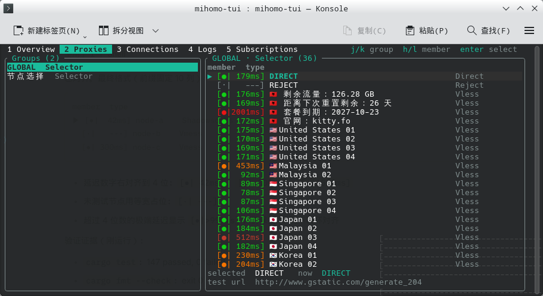
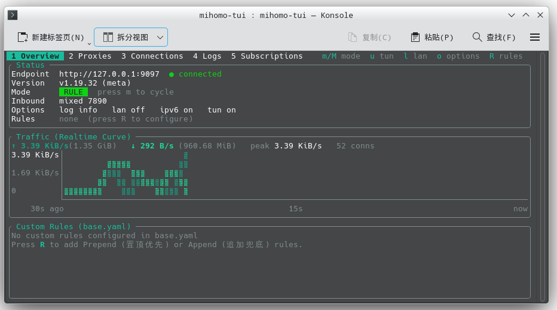
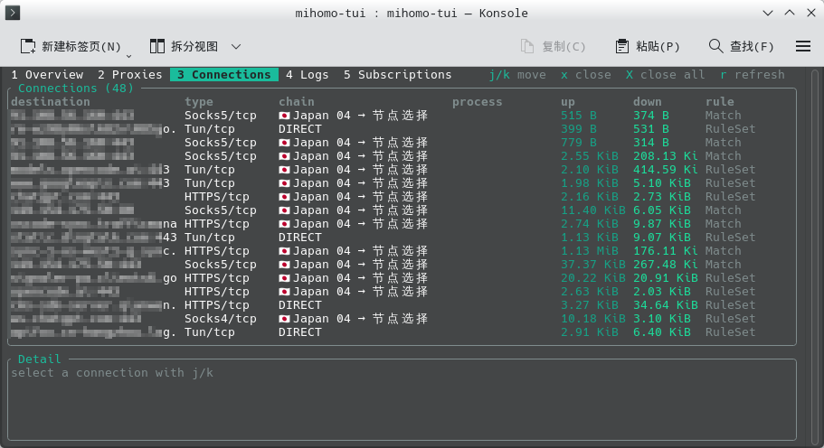
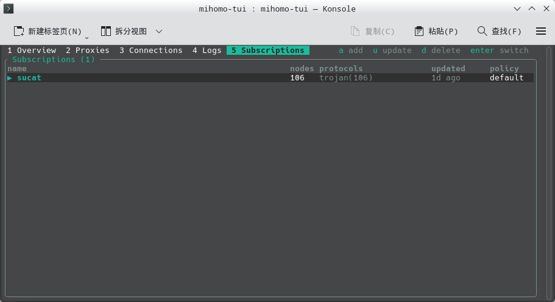
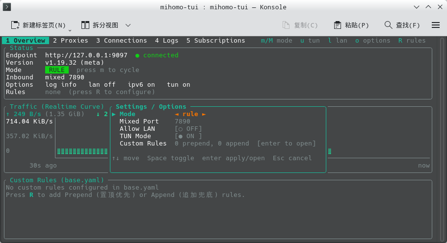

# mihomo-tui

[简体中文](README.md) | **English**

A terminal UI for the [mihomo](https://github.com/MetaCubeX/mihomo) (Clash.Meta)
external controller. It talks to the same REST API the web dashboard uses, so it
works against any mihomo instance that exposes `external-controller` — no extra
agent, no config changes beyond the controller block.



## Features

Five tabs, switchable with `1`–`5` or `tab`:

| Tab | What it shows |
| --- | --- |
| **Overview** | Version, current routing mode, inbound ports, log level / LAN / IPv6 / TUN flags, live up/down rates with sparklines, cumulative transfer totals |
| **Proxies** | Every selector-ish group and its members, each node led by a `[●|42ms]` status prefix coloured by latency; select a member, test one member or the whole group |
| **Connections** | Live connection table (destination, type, proxy chain, process, up/down, matched rule) with a detail pane; close one or all |
| **Logs** | The live `/logs` stream, colour-coded by level |
| **Subscriptions** | Import/update/delete subscriptions; per-block diff and merge of the base config with hot reload, remembered policy, concurrent testing |

The UI is a single-threaded render loop; all network I/O happens on background
tasks behind a pair of channels, so nothing blocks on a slow controller. The
`/traffic` and `/logs` streams reconnect on their own when mihomo drops them
(which it does on every config reload).

## Screenshots

**Overview** — version, current mode, live traffic curve, and custom rules.



**Connections** — live connections; `x` / `X` closes one or all.



**Subscriptions** — subscriptions, node counts, protocols, and policy.



**Settings / Options** — switch mode, port, TUN, LAN, and custom rules without leaving the terminal.



## Requirements

- A running mihomo with the external controller enabled:

  ```yaml
  external-controller: 127.0.0.1:9090
  secret: ""            # optional; pass it with --secret if set
  ```

- Rust 1.85+ (edition 2024) to build from source.

## Build

```sh
cargo build --release
# binary at target/release/mihomo-tui
```

## Usage

```
mihomo-tui [OPTIONS]

OPTIONS:
    --endpoint <URL>     Controller address          [default: http://127.0.0.1:9090]
    --secret <SECRET>    Bearer token, if the controller requires one
    --delay-url <URL>    URL used for latency tests
                                                    [default: http://www.gstatic.com/generate_204]
    --timeout <MS>       Per-test timeout in ms      [default: 5000]
    --refresh <MS>       State refresh interval in ms [default: 2000]
    --log-level <LEVEL>  Log stream level: debug|info|warning|error [default: info]
    --config-dir <DIR>   State directory (profiles, base/runtime configs, TUI settings) [default: ~/.config/mihomo-tui]
    --concurrency <N>    Concurrent delay tests [default: 8]
    -h, --help           Print this help
```

Both `--flag value` and `--flag=value` are accepted. An endpoint without a
scheme (`127.0.0.1:9090`) is completed to `http://`.

```sh
mihomo-tui --secret hunter2
mihomo-tui --endpoint 192.168.1.10:9090 --refresh 1000 --log-level warning
```

## Keys

| Key | Action |
| --- | --- |
| `1`–`5` / `tab` / `shift-tab` | Switch tab |
| `q` / `ctrl-c` | Quit |
| `r` | Refresh now |
| `m` / `M` | Cycle routing mode forward / back *(Overview)* |
| `u` / `l` | Toggle TUN mode / Allow LAN *(Overview)* |
| `j` / `k` | Move down / up in a list |
| `h` / `l` | Move between members *(Proxies)* |
| `enter` / `space` | Select the highlighted member *(Proxies)* |
| `t` / `T` / `A` | Test the highlighted member / the whole group / every node of the current subscription, deduplicated *(Proxies)* |
| `s` | Sort members by measured delay *(Proxies)* |
| `[` / `]` | Cycle to the previous / next subscription *(global)* |
| `v` | Re-apply the current subscription, absorbing external edits *(global)* |
| `o` | Open quick settings / options popup (port, TUN, LAN, mode) *(global)* |
| `a` / `u` / `d` / `enter` | Add / update / delete / switch subscription *(Subscriptions)* |
| mouse | Click tabs, proxy members, subscription rows (disable in config.json) |
| `x` / `X` | Close the highlighted connection / all connections *(Connections)* |
| `c` | Clear the log buffer *(Logs)* |

Latency tests use the group's own `url` when it defines one, falling back to
`--delay-url`. The terminal needs to be at least 48×12; below that the app shows
a hint instead of drawing a mangled layout.

## Subscriptions and configuration

The TUI keeps its own `base.yaml`. Imported subscriptions are snapshotted under
`~/.config/mihomo-tui/subscriptions/<id>.yaml`. Switching a subscription diffs
the base and the snapshot block by block (proxies, proxy-groups, rules, dns, …);
conflicts are resolved per block, each subscription remembers its last choice as
a prefill, and an identical config switches without prompting. On confirm the
TUI renders `runtime.yaml` (atomic write, mode 0600) and hot-loads it into the
controller, rolling back automatically on failure.

`base.yaml` also supports `prepend-rules` (top-priority custom rules) and `append-rules` (fallback rules); prepend rules are placed at the very front of the rules list to ensure custom routing takes precedence even when using subscription rules.

External edits to `base.yaml` or a snapshot are never applied silently: the TUI
enters a pending state and `v` shows the diff before reloading. `runtime.yaml`
carries `external-controller` and `secret`, so a system service can point at it
and keep its endpoint across reloads; note that this writes the secret to disk
once more, under mode 0600.

Watching is a 1-second poll of `(mtime, size)` — no extra dependency.

### State directory

```
~/.config/mihomo-tui/
  config.json        # TUI settings (concurrency, mouse)
  base.yaml          # your base config
  runtime.yaml       # generated config handed to mihomo (0600)
  profiles.json      # subscription index and remembered policy (0600)
  subscriptions/     # one snapshot per subscription (0600)
```

## Development

```sh
cargo test              # unit + render-snapshot tests
cargo clippy --all-targets
cargo fmt
```

Rendering is tested against ratatui's `TestBackend`, so the tests assert on the
text a user would actually see rather than on internal state alone. The API
types are tested against captured mihomo payloads — including `"connections":
null`, which mihomo sends whenever nothing is open.
